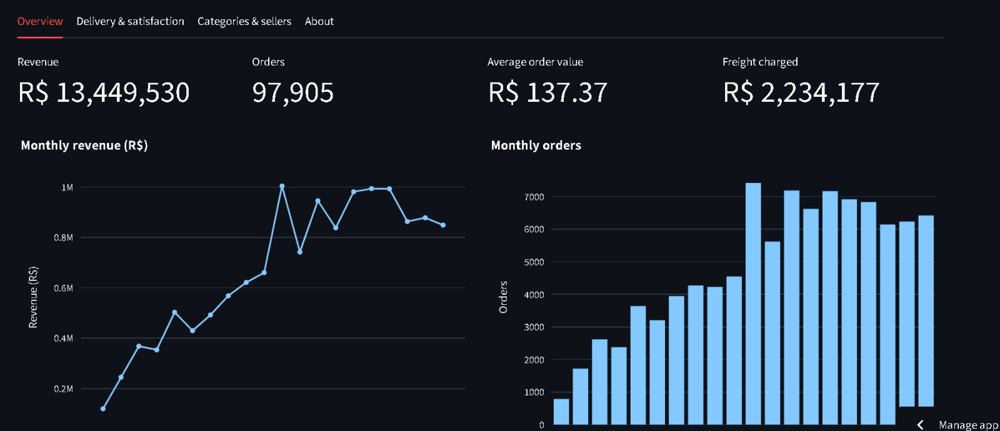
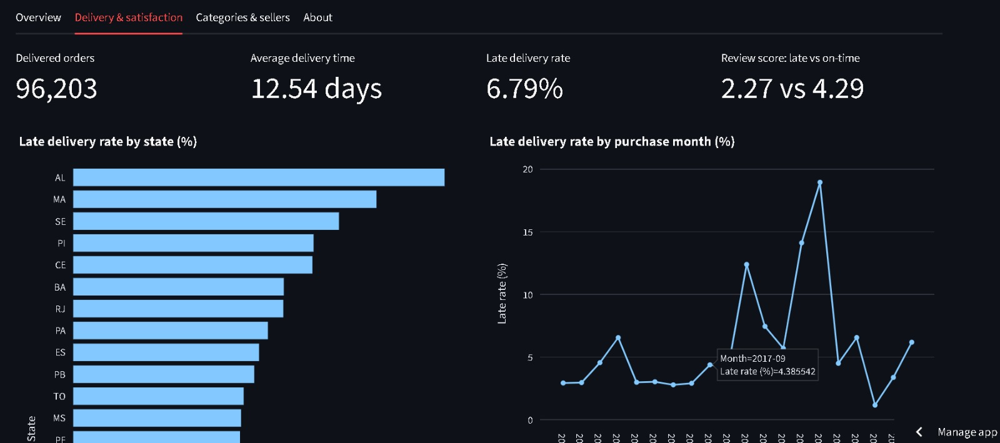
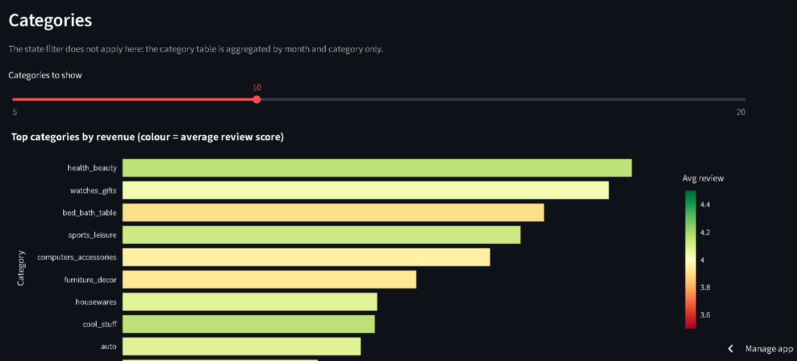
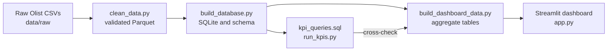

# Olist E-commerce BI Pipeline

**Live dashboard:** https://ecommerce-bi-pipeline.streamlit.app/

An end-to-end analytics project on the Olist Brazilian e-commerce dataset (about 100,000 orders, 2016-2018). Raw CSVs are profiled and cleaned in Python, loaded into a SQLite database with a constrained schema, summarized with SQL KPI queries, and published as an interactive Streamlit dashboard. Every number the dashboard shows is cross-checked against an independent calculation.



| Delivery and satisfaction | Categories and sellers |
|---|---|
|  |  |

## Business questions

- How have revenue, orders and average order value developed month by month?
- How fast are orders delivered, how often are they late, and how does lateness relate to customer reviews?
- Which states, categories and sellers drive revenue, and where are customers least satisfied?
- How concentrated is seller revenue, and how often do customers buy again?

## Architecture



## Key findings

Scope: orders that count as sales (not canceled or unavailable), placed 2017-01 to 2018-08, the complete months. Revenue is item price in Brazilian reais (R$), excluding freight. These are observations from one historical dataset, not causal claims.

- **Size:** 97,905 orders, R$ 13.45M revenue, average order value R$ 137.37, plus R$ 2.23M freight.
- **Growth then plateau:** monthly revenue rose from about R$ 0.12M (2017-01) to about R$ 1.0M (2017-11), then stayed roughly between R$ 0.84M and R$ 0.99M through 2018-08.
- **A one-day spike on top of a step up:** 2017-11-24 had 1,166 orders, 8.2x the October 2017 daily median. That is consistent with Black Friday, but the dataset has no promotion flag, so the link is likely, not proven.
- **Delivery:** 96,203 delivered orders, average 12.54 days (median 10.21), 6.79% delivered after the estimated date.
- **Late delivery and reviews:** late orders average 2.27 stars versus 4.29 for on-time or early orders. This is an association; late orders may differ in other ways.
- **Geography matters:** São Paulo averages 8.7 days; Amazonas, Alagoas and Pará average 24 to 26 days. Alagoas has the highest late rate (21.5%). Amazonas and Rondônia have the largest buffer between promised and actual delivery time (about 19.5 and 20.4 days) and low late rates (2.8% and 2.9%).
- **Rio de Janeiro stands out:** 12.1% late across 12,310 delivered orders, against 4.1% to 4.6% for São Paulo, Minas Gerais and Paraná. I did not test why.
- **Seller concentration:** the top 10% of the 3,029 active sellers earn 67.3% of revenue.
- **Repeat purchases are rare:** 3.04% of 94,707 customers ordered more than once in the window.
- **Categories:** `health_beauty` (9.3% of revenue) and `watches_gifts` (8.9%) lead. Among categories with at least 300 orders, `office_furniture` has the lowest average review (3.49).

## Data quality decisions

Cleaning rules come from evidence in the raw data, documented in [docs/cleaning_decisions.md](docs/cleaning_decisions.md). Highlights:

- `review_id` is reused across different orders (789 ids), so the pipeline keeps one review per order (the latest) and records `review_count`.
- 775 orders have no item rows (almost all `unavailable` or `canceled`). They are kept but contribute no revenue.
- 23 orders were delivered before carrier pickup and 9 payments have a value of 0. They are flagged and kept.
- 610 products have no category (labelled `unknown`); 13 products lacked an English category, and 2 category names were translated manually.
- Geolocation: 42 points outside a rough Brazil bounding box were dropped, and each zip prefix uses the median coordinate.
- Items price plus freight (R$ 15,843,410) and payments (R$ 15,846,280) differ by about 0.02% across all orders. I did not investigate the cause, so revenue is defined from item prices only.

## How correctness is checked

- The cleaning script runs about 20 validation checks (keys, referential integrity, ranges) before writing any file.
- The database loader verifies row counts, SQLite integrity and foreign keys, and compares one revenue figure between pandas and SQL.
- KPI results are recomputed independently in pandas (monthly orders and revenue), and the EDA notebook asserts that its numbers match the SQL results.
- The dashboard's aggregate tables are validated against the SQL KPIs before they are saved.
- 72 automated `pytest` tests cover dashboard math, cleaning rules, schema constraints and the committed output files.

## Tech stack

Python 3.12, pandas, SQLite and SQL (window functions), Parquet, Plotly, Streamlit, Jupyter, pytest, Git and GitHub, Streamlit Community Cloud.

## Repository layout

```text
.
├── app.py                      # Streamlit dashboard
├── dashboard_data/             # small aggregate tables the dashboard reads (committed)
├── data/                       # raw and processed data (git-ignored, not in the repo)
├── docs/                       # cleaning decisions, KPI definitions, profiling reports, images
├── notebooks/                  # EDA notebook (01_eda.py and 01_eda.ipynb)
├── sql/                        # schema.sql, kpi_queries.sql, dashboard_queries.sql
├── src/                        # pipeline scripts and dashboard_metrics.py
├── tests/                      # pytest tests
├── pytest.ini
├── requirements.txt            # runtime dependencies (used by the deployed app)
└── requirements-dev.txt        # full development environment (frozen on Windows)
```

## Run it yourself

**Dashboard only** (uses the committed aggregate tables, no raw data needed):

```powershell
git clone https://github.com/Devax27/ecommerce-bi-pipeline.git
cd ecommerce-bi-pipeline
python -m venv .venv
.\.venv\Scripts\Activate.ps1
pip install -r requirements.txt
streamlit run app.py
```

**Full pipeline:** `requirements-dev.txt` was frozen on Windows. On macOS or Linux, delete its Windows-only `pywinpty` line before installing.

1. Install everything with `pip install -r requirements-dev.txt`.
2. Download the dataset from [Kaggle](https://www.kaggle.com/datasets/olistbr/brazilian-ecommerce) (a free account is needed) and extract the CSV files into `data/raw`.
3. Run the stages in order, from the project root:

```powershell
python src\clean_data.py
python src\build_database.py
python src\run_kpis.py
python src\build_dashboard_data.py
pytest
```

## Limitations

- Historical data (2016-2018) from one marketplace; it says nothing about the current market.
- Associations, such as late delivery and low reviews, are not proof of causation.
- Timestamps are used as recorded; the dataset does not document their time zone.
- The dashboard's category and seller tables are not affected by the state filter, because they are aggregated by month and category only.
- Distinct-customer counts cannot be recombined across filters, so repeat-purchase figures cover the full period only.

## Data attribution and license

Data: [Brazilian E-Commerce Public Dataset by Olist](https://www.kaggle.com/datasets/olistbr/brazilian-ecommerce), licensed under [CC BY-NC-SA 4.0](https://creativecommons.org/licenses/by-nc-sa/4.0/). The raw data is not included in this repository. The tables in `dashboard_data/` and the charts in `docs/images/` are modified aggregates of that data, shared under the same license for non-commercial use. Credit for the underlying data belongs to Olist.

Author: [@Devax27](https://github.com/Devax27)